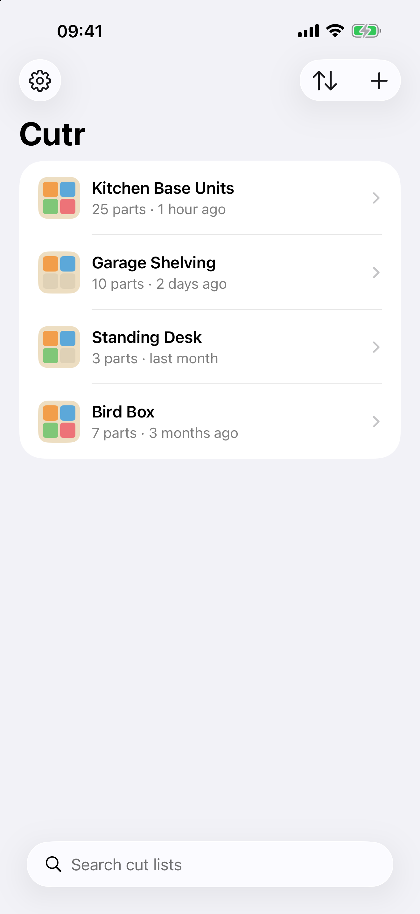
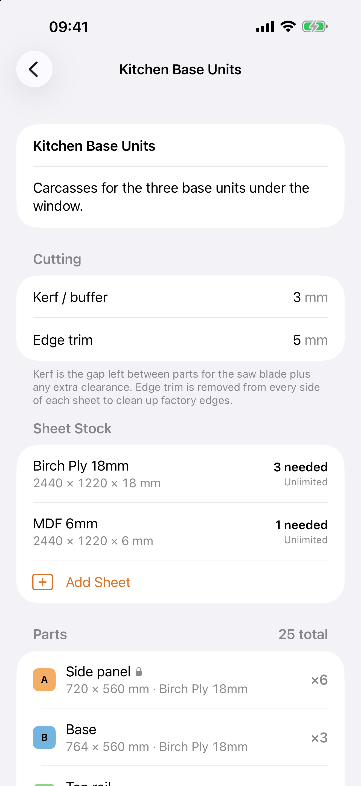
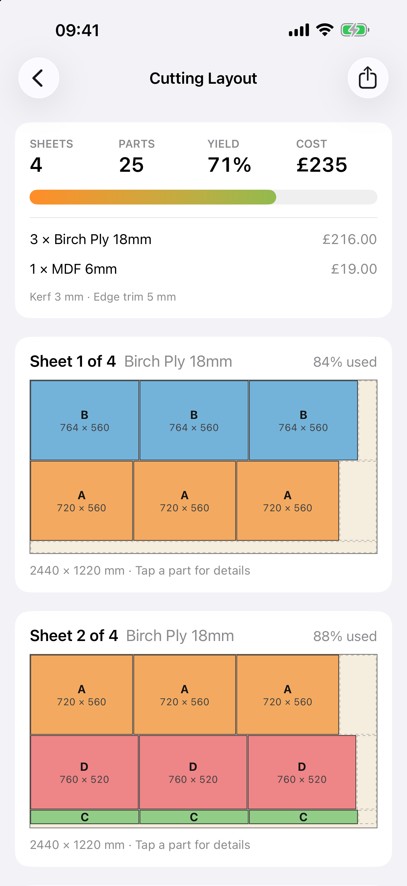

<p align="center">
  
</p>

<h1 align="center">Cutr</h1>

<p align="center">
  Sheet cutting optimiser for iPhone and iPad.<br>
  Enter your sheet sizes and the parts you need. Cutr works out the most efficient way to cut them.
</p>

<p align="center">
  
  
  
</p>

## Features

- **Guillotine optimiser** – every layout can be cut with straight, edge-to-edge cuts on a table saw, track saw or panel saw. Cutr tries 120 combinations of sort order, placement and split rules and keeps the layout that uses the fewest sheets and leaves the biggest usable offcut.
- **Kerf / buffer** – set the gap left between parts for the blade and any extra clearance.
- **Edge trim** – remove damaged factory edges from every side of a sheet.
- **Grain direction lock** – stop individual parts from being rotated.
- **Multiple materials** – mix sheet types (e.g. 18 mm ply and 6 mm MDF) in one cut list, with limited or unlimited stock.
- **Cost and yield** – price per sheet, total cost and percentage of material used.
- **Saved cut lists** – name, search, duplicate and sort by name, date created, date modified or number of parts.
- **iCloud sync** – cut lists sync between iPhone and iPad through your private iCloud database.
- **PDF export and printing** – a printable cut sheet with parts table and a diagram of every sheet.
- **Metric and imperial** – millimetres, centimetres or inches with fractions (`23 7/16`).

## Building

Requirements: Xcode 26 or later, [XcodeGen](https://github.com/yonaskolb/XcodeGen).

```sh
brew install xcodegen
xcodegen generate
open Cutr.xcodeproj
```

The Xcode project is generated from `project.yml` and is not committed.

To build under your own Apple Developer account, change `DEVELOPMENT_TEAM`, the bundle identifier and the iCloud container in `project.yml` and `Cutr/Cutr.entitlements`.

### Tests

```sh
xcodebuild test -project Cutr.xcodeproj -scheme Cutr \
  -destination 'platform=iOS Simulator,name=iPhone 17 Pro'
```

Unit tests check that the optimiser never overlaps parts, always respects the kerf and trim, honours grain locks and stock limits. UI tests cover creating a cut list, adding parts, sorting and duplicating.

### Screenshots

```sh
Scripts/screenshots.sh
```

Launches the app with `-demo` (in-memory sample data) on iPhone and iPad simulators and saves App Store screenshots to `docs/screenshots`.

## Project layout

| Path | Contents |
| --- | --- |
| `Cutr/Models` | SwiftData models (`Project`, `StockSheet`, `Part`) and length units |
| `Cutr/Optimizer` | The guillotine bin-packing optimiser |
| `Cutr/Views` | SwiftUI views |
| `Cutr/Export` | Sheet drawing, PDF export and printing |
| `Scripts` | App icon generator and screenshot script |

## Privacy

Cutr collects no data. See [PRIVACY.md](PRIVACY.md).

## Licence

MIT – see [LICENSE](LICENSE).
